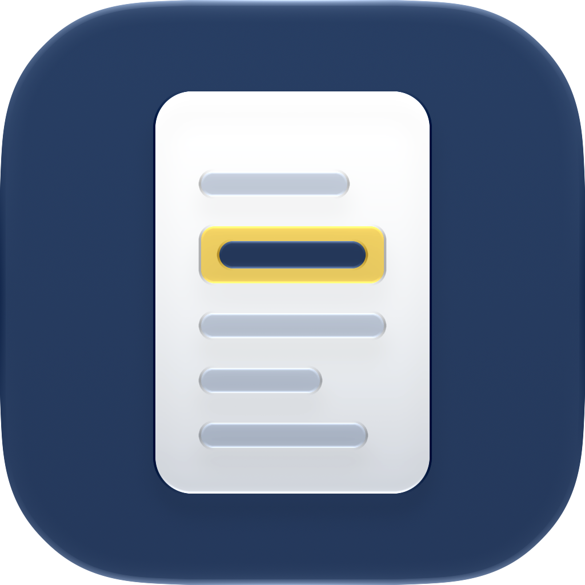

# RuleRef

[🇺🇸 English](#english) · [🇪🇸 Español](#español)

## English

*[🇪🇸 Versión en español](#español)*

An iPhone rulebook referee for board games: import a game's PDF rulebook, search it, and see the original rule on its page with the passage highlighted.

### In short

- **What it is:** the final project for DevExpert's AI Expert course (October 2026), built by one developer with Claude Code.
- **What it really shows:** the harness, the system that builds the app. One agent implements, another validates, and I decide. The app is small on purpose; it is the test bed.
- **Where it stands:** the base app without AI is complete (tag `m4`): import, search, an explicit no-match state and the page viewer with the passage highlighted. 17 of 19 features are accepted; the other 2 are deferred until after delivery. Text search is measured against real questions (see [Baseline](#baseline-text-search-on-real-questions)). On-device AI is the next feature of the loop, measured against that baseline.

### Where to find each part

| Looking for | Where it is |
|---|---|
| The process with AI, from the first research to each finished feature | [How it was built](#how-it-was-built), and [`PROGRESS.md`](PROGRESS.md), one entry per work session |
| A harness of my own, built and configured | [The harness, piece by piece](#the-harness-piece-by-piece) |
| The course concepts applied in the project | [Course concepts in this repo](#course-concepts-in-this-repo) |
| What works today | [`feature_list.json`](feature_list.json), with the evidence of every feature, and the demo in the video |

### What the app does

- A library of games, each holding at most one rulebook imported from a single-column PDF with a text layer.
- Import once, then use it offline: the rulebook is frozen into ordered passages, each with a page locator.
- Text search inside one game's rulebook, case- and diacritic-insensitive, with an explicit no-match state instead of approximate results.
- Open a match in the page viewer with the passage highlighted.

### How it was built

| When | What | Where |
|---|---|---|
| 6 Oct | Decide before coding: the idea, the stack closed in an ADR, a discovery interview that produced the brief, the domain model, the glossary and the open decisions, and a scope cut with its reason | [`docs/`](docs/), [`CONTEXT.md`](CONTEXT.md), [ADR-001](docs/adr/0001-stack-and-build-doctrine.md), [ADR-003](docs/adr/0003-scope-cut.md) |
| 7 Oct | The minimal harness: hooks and permissions, the `init.sh` gate, `AGENTS.md`, `feature_list.json` and `PROGRESS.md`; then the loop: implementer, validator and orchestrator. Tag `m3` | [`.claude/`](.claude/), [`init.sh`](init.sh), [`AGENTS.md`](AGENTS.md) |
| 8–13 Oct | A spec per feature, reviewed against the repo and Apple's documentation, approved by me before any code | [`docs/specs/`](docs/specs/) |
| 14 Oct | The Xcode MCP, read-only; the first feature through the loop and its PR | [ADR-001](docs/adr/0001-stack-and-build-doctrine.md) (revision), PR #1 |
| 14–16 Oct | Every feature through the loop, one branch and one PR each, merged by me, with manual checks on an iPhone 16. When something did not fit, the system stopped: I rejected an `accept` (f02), the implementer stopped on two spec gaps (f07, f18) and the validator asked for one revision (f15) | [`docs/validations/`](docs/validations/), PRs #2–#17 |
| 16 Oct | Tag `m4`; an eval set of real questions and the measured baseline | [Baseline](#baseline-text-search-on-real-questions) |

### The harness, piece by piece

Origin: **course** = DevExpert's [harness-starter](https://github.com/devexpert-io/harness-starter) at `18b19e6`, copied unchanged; **course, adapted** = changed for this stack; **mine** = written for this project; **my kit** = from my own hooks kit, which predates the course.

| Piece | What it does | Origin | Evidence in this repo |
|---|---|---|---|
| [`build-brief`](.agents/skills/build-brief/SKILL.md) skill | Discovery interview, one question at a time, that closes the MVP before any code | course, adapted to native iOS | The four discovery documents in `docs/` and `CONTEXT.md` |
| [`AGENTS.md`](AGENTS.md) | Rules, workflow and Definition of Done that every session reads first; `CLAUDE.md` only imports it | mine, on the course's pattern | A fresh session without memory rebuilt the state from the repo alone (7 Oct) |
| [`init.sh`](init.sh) | The one gate: 11 checks for house rules, a warnings-as-errors build, the tests and the string catalog | mine, on the course's idea of one command | Run by a hook at the end of every agent turn that changes a non-Markdown file |
| [`feature_list.json`](feature_list.json) and [`PROGRESS.md`](PROGRESS.md) | The state: status, dependencies and evidence per feature, and a log of work sessions | course format, extended: evidence with context and a `not_verified` list, validated by `init.sh` | Every accepted feature has its evidence |
| [`feature-spec`](.agents/skills/feature-spec/SKILL.md) skill | Turns a feature into a contract another agent can implement without the chat | course | 17 approved specs |
| [`feature-implementer`](.agents/skills/feature-implementer/SKILL.md) skill and [subagent](.claude/agents/feature-implementer.md) | Implements one feature; a gap in the spec is a stop, never its own decision | mine | Stops on f07 and f18 |
| [`feature-validator`](.agents/skills/feature-validator/SKILL.md) skill and [subagent](.claude/agents/feature-validator.md) | Re-runs the gate, reviews the change against the spec and gives a verdict, read-only | skill: course; subagent: mine | One record per feature in `docs/validations/` |
| [`feature-flow`](.agents/skills/feature-flow/SKILL.md) skill | The orchestrator behind `/feature-flow`: branch, implement, validate, record, ask me, open the PR. At most 3 revisions per spec | mine, on the course's loop | PRs #2–#17 |
| Loop hooks: `spec-approval-guard`, `implementer-no-accept`, `validator-readonly-bash`, `xcode-mcp-write-guard` | No agent approves a spec, the implementer cannot accept, the validator cannot write, and Xcode MCP tools that write are blocked | mine | 100 test cases in [`.claude/hooks/tests/`](.claude/hooks/tests/) |
| Generic hooks: `protect-files`, `block-dangerous-commands`, `secrets-commit-guard`, `constitution-lint`, `stop-build-gate` | The Xcode project, secrets and `.git` are off limits; dangerous commands are blocked; Swift rules are linted; the gate runs on Stop | my kit | A planted `JSONSerialization` was caught (7 Oct) |
| [`.claude/settings.json`](.claude/settings.json) | Permissions: merge denied (I merge on GitHub), push asks, concrete allows | mine | — |
| Xcode MCP, read-only, and the [`xcode-mcp`](.agents/skills/xcode-mcp/SKILL.md) skill | IDE diagnostics and documentation without letting an agent change the project | mine | ADR-001, revision of 14 Oct |

### Reusing the harness without the app

- **Portable as it is:** `.agents/skills/` (except the steering block of `build-brief` and the `xcode-mcp` skill), `.claude/agents/`, `.claude/hooks/` with its tests, the shape of `AGENTS.md`, the `feature_list.json` schema and its check, the `PROGRESS.md` format, and the `docs/specs/` and `docs/validations/` layout.
- **To change for another project:** the rules and build commands in `init.sh`; the protected paths in the hooks; the validator's Bash allowlist (`xcodebuild` is the test runner here); the project rules in `AGENTS.md`; the `allow` entries in `settings.json`.
- **Project only, leave behind:** `RuleRef/`, `RuleRefTests/`, `RuleRef.xcodeproj`, the decisions in `docs/` and the ADRs, and the eval set.

### Course concepts in this repo

| Module | Concept | Where it is applied |
|---|---|---|
| M1 | A harness is context, instructions and checks; discovery with `build-brief` before any code | `AGENTS.md`, `init.sh`, the hooks; `docs/` |
| M2 | Context engineering: a short `AGENTS.md`, `CLAUDE.md` importing it, a glossary; Spec-Driven Development; the harness-starter files | `AGENTS.md`, `CONTEXT.md`, `docs/specs/`, `feature_list.json`, `PROGRESS.md` |
| M3 | Hooks as deterministic checks; permissions; implementer and validator subagents | `.claude/hooks/`, `.claude/settings.json`, `.claude/agents/` |
| M4 | Loop engineering: an orchestrator, gates and a revision limit, GitHub flow with a branch and PR per feature. Worktrees and parallel features were cut on purpose ([ADR-003](docs/adr/0003-scope-cut.md)); there is no CI yet | `feature-flow`, `docs/validations/`, the PRs |
| M5 | LLM fundamentals, on-device models and RAG: measure before adding AI | The eval set and the [baseline](#baseline-text-search-on-real-questions); the on-device AI layer comes next |
| M6 | After the class | — |

### Baseline: text search on real questions

25 questions about the Taifa rulebook, worded the way someone who does not know the rulebook would ask ([eval set](RuleRefTests/Fixtures/taifa-3.0-eval.json)), scored by page. Measured on the iOS 27.0 simulator:

| Metric | Result |
|---|---|
| Right page first (hit@1) | 3 of 21 |
| Right page in the first three (hit@3) | 4 of 21 |
| Says "no results" when the answer is not in the rulebook | 3 of 4 |

Search needs every word of the query in the same passage, so most questions find nothing. That is the number the AI has to beat. Full report: [`docs/eval/f16-baseline-taifa-3.0.json`](docs/eval/f16-baseline-taifa-3.0.json).

### Stack

iOS 26+, iPhone only, Swift 6, SwiftUI, SwiftData, Swift Testing, PDFKit, no third-party dependencies, built and tested via `xcodebuild`. See [ADR-001](docs/adr/0001-stack-and-build-doctrine.md).

### Build and test

`./init.sh` is the only command: it checks the toolchain and simulator, enforces the source rules (no JSONSerialization, UIKit, XCTest, third-party packages or bundled PDFs; Spanish translations complete; a valid `feature_list.json`), then builds with warnings as errors, runs the tests and checks that every string the compiler extracts from the app is in the catalog (the CLI build never adds them; add each key with its Spanish translation by hand). Requires Xcode 27 and an iPhone 18 Pro simulator with iOS 27.0.

### Documentation

- [`ARCHITECTURE.md`](ARCHITECTURE.md): folders of the app and test targets, and what each may use.
- [`DESIGN.md`](DESIGN.md): interface rules: SF Symbols, standard button roles and previews with sample data.
- [`AGENTS.md`](AGENTS.md): instructions for coding agents, with rules, workflow and Definition of Done. [`CLAUDE.md`](CLAUDE.md) only imports it.
- [`.agents/skills/`](.agents/skills/): the harness skills. `.claude/` holds the subagents, hooks and settings that wire them; [`.claude/hooks/README.md`](.claude/hooks/README.md) lists the hooks.
- [`feature_list.json`](feature_list.json): status of every feature, with dependencies, verification steps and evidence.
- [`docs/specs/`](docs/specs/) and [`docs/validations/`](docs/validations/): the approved spec and the validation record of each feature.
- [`docs/eval/`](docs/eval/): baseline reports of search on the eval set, exported from a focused test run.
- [`docs/idea.md`](docs/idea.md): original idea, course context and initial decisions (Spanish).
- [`docs/build-brief.md`](docs/build-brief.md): problem, goals, non-goals and feature slices up to m4.
- [`docs/domain-model.md`](docs/domain-model.md): core concepts and rules.
- [`docs/risks-and-open-questions.md`](docs/risks-and-open-questions.md): status of open decisions, assumptions and risks.
- [`docs/adr/`](docs/adr/): ADR-001 stack and CLI build doctrine; ADR-002 PDFKit line order, no reading-order reconstruction; ADR-003 scope cut; ADR-004 page viewer with PDFKit's `PDFView`, the one UIKit-backed view.
- [`CONTEXT.md`](CONTEXT.md): glossary of canonical terms.
- [`PROGRESS.md`](PROGRESS.md): log of work sessions, recording what closed and what comes next.

### Demo rulebook

The demo uses Taifa 3.0 (CC BY-NC-SA). It is used only as a test fixture and is never bundled in the app.

---

## Español

*[🇺🇸 English version](#english)*

Un árbitro de reglamentos de juegos de mesa para iPhone: importas el reglamento en PDF de un juego, buscas en él y ves la regla original en su página, con el pasaje resaltado.

### En resumen

- **Qué es:** el proyecto final del curso AI Expert de DevExpert (octubre de 2026), hecho por un solo desarrollador con Claude Code.
- **Qué enseña de verdad:** el harness, el sistema con el que se construye la app. Un agente implementa, otro valida y yo decido. La app es pequeña a propósito: es el banco de pruebas.
- **En qué punto está:** la app base sin IA está terminada (tag `m4`): importar, buscar, un estado explícito de sin resultados y el visor de página con el pasaje resaltado. 17 de las 19 features están aceptadas; las otras 2 quedan para después de la entrega. La búsqueda de texto está medida con preguntas reales (ver [Línea base](#línea-base-la-búsqueda-de-texto-con-preguntas-reales)). La IA en el dispositivo es la siguiente feature del loop, medida contra esa línea base.

### Dónde está cada cosa

| Si buscas | Dónde está |
|---|---|
| El proceso con IA, desde la primera investigación hasta cada feature terminada | [Cómo se construyó](#cómo-se-construyó), y [`PROGRESS.md`](PROGRESS.md), una entrada por sesión de trabajo |
| Un harness propio, montado y configurado | [El harness, pieza a pieza](#el-harness-pieza-a-pieza) |
| Los conceptos del curso aplicados al proyecto | [Conceptos del curso en este repo](#conceptos-del-curso-en-este-repo) |
| Lo que funciona hoy | [`feature_list.json`](feature_list.json), con la evidencia de cada feature, y la demo del vídeo |

### Qué hace la app

- Una biblioteca de juegos; cada uno guarda como mucho un reglamento, importado de un PDF a una columna con capa de texto.
- Se importa una vez y se usa sin conexión: el reglamento queda fijado en pasajes ordenados, cada uno con su página.
- Búsqueda de texto dentro del reglamento de un juego, sin distinguir mayúsculas ni tildes, con un estado explícito de sin resultados en lugar de resultados aproximados.
- Una coincidencia se abre en el visor de página con el pasaje resaltado.

### Cómo se construyó

| Cuándo | Qué | Dónde |
|---|---|---|
| 6 oct | Decidir antes de programar: la idea, el stack cerrado en un ADR, una entrevista de descubrimiento que produjo el brief, el modelo de dominio, el glosario y las decisiones abiertas, y un recorte de alcance con su motivo | [`docs/`](docs/), [`CONTEXT.md`](CONTEXT.md), [ADR-001](docs/adr/0001-stack-and-build-doctrine.md), [ADR-003](docs/adr/0003-scope-cut.md) |
| 7 oct | El harness mínimo: hooks y permisos, la puerta `init.sh`, `AGENTS.md`, `feature_list.json` y `PROGRESS.md`; después, el loop: implementador, validador y orquestador. Tag `m3` | [`.claude/`](.claude/), [`init.sh`](init.sh), [`AGENTS.md`](AGENTS.md) |
| 8–13 oct | Una spec por feature, revisada contra el repo y la documentación de Apple, y aprobada por mí antes de escribir código | [`docs/specs/`](docs/specs/) |
| 14 oct | El MCP de Xcode, en solo lectura; la primera feature por el loop y su PR | [ADR-001](docs/adr/0001-stack-and-build-doctrine.md) (revisión), PR #1 |
| 14–16 oct | Todas las features por el loop, una rama y una PR cada una, mergeadas por mí, con comprobaciones a mano en un iPhone 16. Cuando algo no encajaba, el sistema se paraba: rechacé un `accept` (f02), el implementador se paró en dos huecos de spec (f07, f18) y el validador pidió una revisión (f15) | [`docs/validations/`](docs/validations/), PRs #2–#17 |
| 16 oct | Tag `m4`; un eval set de preguntas reales y la línea base medida | [Línea base](#línea-base-la-búsqueda-de-texto-con-preguntas-reales) |

### El harness, pieza a pieza

Origen: **curso** = el [harness-starter](https://github.com/devexpert-io/harness-starter) de DevExpert en `18b19e6`, copiado sin cambios; **curso, adaptado** = cambiado para este stack; **mío** = escrito para este proyecto; **mi kit** = de mi propio kit de hooks, anterior al curso.

| Pieza | Qué hace | Origen | Evidencia en este repo |
|---|---|---|---|
| Skill [`build-brief`](.agents/skills/build-brief/SKILL.md) | Entrevista de descubrimiento, una pregunta cada vez, que cierra el MVP antes de escribir código | curso, adaptada a iOS nativo | Los cuatro documentos de descubrimiento de `docs/` y `CONTEXT.md` |
| [`AGENTS.md`](AGENTS.md) | Reglas, flujo de trabajo y Definition of Done que cada sesión lee primero; `CLAUDE.md` solo lo importa | mío, con el patrón del curso | Una sesión nueva sin memoria reconstruyó el estado leyendo solo el repo (7 oct) |
| [`init.sh`](init.sh) | La única puerta: 11 comprobaciones de reglas de la casa, compilación con los warnings como errores, los tests y el catálogo de textos | mío, con la idea del curso de un solo comando | Lo ejecuta un hook al final de cada turno del agente que cambia un fichero que no es Markdown |
| [`feature_list.json`](feature_list.json) y [`PROGRESS.md`](PROGRESS.md) | El estado: estado, dependencias y evidencia de cada feature, y un registro de las sesiones de trabajo | formato del curso, ampliado: evidencia con contexto y una lista `not_verified`, validada por `init.sh` | Cada feature aceptada tiene su evidencia |
| Skill [`feature-spec`](.agents/skills/feature-spec/SKILL.md) | Convierte una feature en un contrato que otro agente puede implementar sin leer el chat | curso | 17 specs aprobadas |
| Skill [`feature-implementer`](.agents/skills/feature-implementer/SKILL.md) y su [subagente](.claude/agents/feature-implementer.md) | Implementa una feature; un hueco en la spec es una parada, nunca una decisión suya | mío | Paradas en f07 y f18 |
| Skill [`feature-validator`](.agents/skills/feature-validator/SKILL.md) y su [subagente](.claude/agents/feature-validator.md) | Vuelve a ejecutar la puerta, revisa el cambio contra la spec y da un veredicto, solo con lectura | skill: curso; subagente: mío | Un registro por feature en `docs/validations/` |
| Skill [`feature-flow`](.agents/skills/feature-flow/SKILL.md) | El orquestador de `/feature-flow`: rama, implementar, validar, registrar, preguntarme y abrir la PR. Como mucho 3 revisiones por spec | mío, sobre el loop del curso | PRs #2–#17 |
| Hooks del loop: `spec-approval-guard`, `implementer-no-accept`, `validator-readonly-bash`, `xcode-mcp-write-guard` | Ningún agente aprueba una spec, el implementador no puede aceptar, el validador no puede escribir y las herramientas del MCP de Xcode que escriben están bloqueadas | mío | 100 casos de prueba en [`.claude/hooks/tests/`](.claude/hooks/tests/) |
| Hooks genéricos: `protect-files`, `block-dangerous-commands`, `secrets-commit-guard`, `constitution-lint`, `stop-build-gate` | El proyecto de Xcode, los secretos y `.git` no se tocan; los comandos peligrosos se bloquean; las reglas de Swift se revisan; la puerta corre al parar | mi kit | Un `JSONSerialization` plantado quedó detectado (7 oct) |
| [`.claude/settings.json`](.claude/settings.json) | Permisos: el merge está denegado (lo hago yo en GitHub), el push pregunta y los permisos concedidos son concretos | mío | — |
| MCP de Xcode en solo lectura y la skill [`xcode-mcp`](.agents/skills/xcode-mcp/SKILL.md) | Diagnóstico y documentación del IDE sin que un agente pueda cambiar el proyecto | mío | ADR-001, revisión del 14 oct |

### Reutilizar el harness sin la app

- **Se lleva tal cual:** `.agents/skills/` (salvo el bloque de orientación de `build-brief` y la skill `xcode-mcp`), `.claude/agents/`, `.claude/hooks/` con sus tests, la forma de `AGENTS.md`, el esquema de `feature_list.json` y su comprobación, el formato de `PROGRESS.md` y la organización de `docs/specs/` y `docs/validations/`.
- **Hay que cambiarlo en otro proyecto:** las reglas y los comandos de compilación de `init.sh`; las rutas protegidas de los hooks; la lista de comandos permitidos al validador (aquí el runner de tests es `xcodebuild`); las reglas del proyecto en `AGENTS.md`; los permisos `allow` de `settings.json`.
- **Solo del proyecto, se queda aquí:** `RuleRef/`, `RuleRefTests/`, `RuleRef.xcodeproj`, las decisiones de `docs/` y los ADR, y el eval set.

### Conceptos del curso en este repo

| Módulo | Concepto | Dónde se aplica |
|---|---|---|
| M1 | Un harness es contexto, instrucciones y comprobaciones; descubrimiento con `build-brief` antes de escribir código | `AGENTS.md`, `init.sh`, los hooks; `docs/` |
| M2 | Context engineering: un `AGENTS.md` corto, `CLAUDE.md` que lo importa, un glosario; Spec-Driven Development; los ficheros del harness-starter | `AGENTS.md`, `CONTEXT.md`, `docs/specs/`, `feature_list.json`, `PROGRESS.md` |
| M3 | Hooks como comprobaciones deterministas; permisos; subagentes implementador y validador | `.claude/hooks/`, `.claude/settings.json`, `.claude/agents/` |
| M4 | Loop engineering: un orquestador, puertas y un límite de revisiones, GitHub flow con una rama y una PR por feature. Los worktrees y las features en paralelo se recortaron a propósito ([ADR-003](docs/adr/0003-scope-cut.md)); todavía no hay CI | `feature-flow`, `docs/validations/`, las PRs |
| M5 | Fundamentos de LLM, modelos en el dispositivo y RAG: medir antes de añadir IA | El eval set y la [línea base](#línea-base-la-búsqueda-de-texto-con-preguntas-reales); la capa de IA en el dispositivo es lo siguiente |
| M6 | Después de la clase | — |

### Línea base: la búsqueda de texto con preguntas reales

25 preguntas sobre el reglamento de Taifa, formuladas como las haría alguien que no se lo sabe ([eval set](RuleRefTests/Fixtures/taifa-3.0-eval.json)), puntuadas por página. Medido en el simulador de iOS 27.0:

| Métrica | Resultado |
|---|---|
| Página correcta en el primer resultado (hit@1) | 3 de 21 |
| Página correcta entre los tres primeros (hit@3) | 4 de 21 |
| Dice "sin resultados" cuando la respuesta no está en el reglamento | 3 de 4 |

La búsqueda exige todas las palabras de la consulta en el mismo pasaje, así que la mayoría de las preguntas no encuentran nada. Ese es el número que tiene que mejorar la IA. Informe completo: [`docs/eval/f16-baseline-taifa-3.0.json`](docs/eval/f16-baseline-taifa-3.0.json).

### Stack

iOS 26+, solo iPhone, Swift 6, SwiftUI, SwiftData, Swift Testing, PDFKit, sin dependencias de terceros, compilado y probado con `xcodebuild`. Ver [ADR-001](docs/adr/0001-stack-and-build-doctrine.md).

### Compilar y probar

`./init.sh` es el único comando: comprueba el toolchain y el simulador, hace cumplir las reglas del código (nada de JSONSerialization, UIKit, XCTest, paquetes de terceros ni PDFs dentro de la app; traducciones al español completas; un `feature_list.json` válido), compila con los warnings como errores, pasa los tests y comprueba que cada texto que el compilador extrae de la app está en el catálogo (la compilación por línea de comandos nunca los añade; cada clave se añade a mano con su traducción al español). Necesita Xcode 27 y un simulador iPhone 18 Pro con iOS 27.0.

### Documentación

La documentación del repo está en inglés, salvo `docs/idea.md`.

- [`ARCHITECTURE.md`](ARCHITECTURE.md): carpetas de los targets de la app y de los tests, y qué puede usar cada una.
- [`DESIGN.md`](DESIGN.md): reglas de interfaz: SF Symbols, roles estándar de los botones y previews con datos de ejemplo.
- [`AGENTS.md`](AGENTS.md): instrucciones para los agentes, con reglas, flujo de trabajo y Definition of Done. [`CLAUDE.md`](CLAUDE.md) solo lo importa.
- [`.agents/skills/`](.agents/skills/): las skills del harness. `.claude/` guarda los subagentes, los hooks y la configuración que las conecta; [`.claude/hooks/README.md`](.claude/hooks/README.md) lista los hooks.
- [`feature_list.json`](feature_list.json): estado de cada feature, con dependencias, pasos de verificación y evidencia.
- [`docs/specs/`](docs/specs/) y [`docs/validations/`](docs/validations/): la spec aprobada y el registro de validación de cada feature.
- [`docs/eval/`](docs/eval/): informes de la línea base de la búsqueda sobre el eval set, exportados de una ejecución de tests enfocada.
- [`docs/idea.md`](docs/idea.md): idea original, contexto del curso y decisiones iniciales.
- [`docs/build-brief.md`](docs/build-brief.md): problema, objetivos, lo que queda fuera y los cortes de features hasta m4.
- [`docs/domain-model.md`](docs/domain-model.md): conceptos y reglas del dominio.
- [`docs/risks-and-open-questions.md`](docs/risks-and-open-questions.md): estado de las decisiones abiertas, suposiciones y riesgos.
- [`docs/adr/`](docs/adr/): ADR-001, stack y doctrina de compilación por línea de comandos; ADR-002, orden de líneas de PDFKit sin reconstruir el orden de lectura; ADR-003, recorte de alcance; ADR-004, visor de página con `PDFView` de PDFKit, la única vista basada en UIKit.
- [`CONTEXT.md`](CONTEXT.md): glosario de términos canónicos.
- [`PROGRESS.md`](PROGRESS.md): registro de las sesiones de trabajo, con lo que se cerró y lo que viene después.

### Reglamento de la demo

La demo usa Taifa 3.0 (CC BY-NC-SA). Se usa solo como fixture de test y nunca va dentro de la app.
